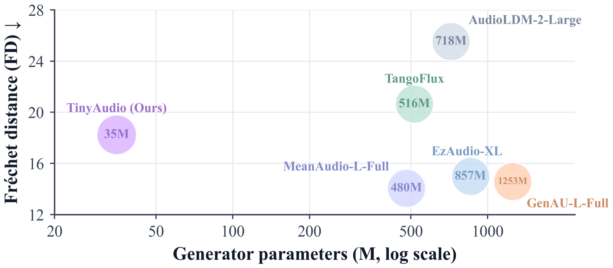

<div align="center">

<h1>TinyAudio</h1>

<h3>Compact and Efficient Text-to-Audio Generation for Low-Resource Deployment</h3>

[](https://arxiv.org/abs/2609.31525)
[](https://tinyaudio-project.github.io/)
[](https://huggingface.co/junxiliu/TinyAudio)
[](LICENSE)
[](pyproject.toml)

<b>
<a href="#-quick-start">Quick Start</a> ·
<a href="#-models">Models</a> ·
<a href="#-training">Training</a> ·
<a href="#-evaluation">Evaluation</a> ·
<a href="#-citation">Citation</a>
</b>

</div>

## 🔥 News

- **[Oct. 2026]** We release [TinyAudio](https://huggingface.co/junxiliu/TinyAudio/blob/main/weights/tinyaudio.pth), [TinyAudio-MF](https://huggingface.co/junxiliu/TinyAudio/blob/main/weights/tinyaudio_mf.pth) and the [CPU package](https://huggingface.co/junxiliu/TinyAudio/tree/main/cpu/standard) on [🤗 Hugging Face](https://huggingface.co/junxiliu/TinyAudio). Checkpoints are downloaded automatically on first use.
- **[Oct. 2026]** We release the training and inference code of TinyAudio and TinyAudio-MF, with an ONNX Runtime package for CPU inference.
- **[Sep. 2026]** The TinyAudio paper is available on [arXiv](https://arxiv.org/abs/2609.31525).

## 📖 Overview

TinyAudio is a complete text-to-audio system with only 87M parameters, covering the text encoder, the generator and the decoder.
It generates 44.1 kHz audio with 0.48 GB of peak GPU memory, over 8x less than every compared system.
Its one-step variant, TinyAudio-MF, generates audio in real time on a four-core CPU quota.

<div align="center">
  
</div>

## ⚙️ Environment Setup

**1. Create a conda environment**

```bash
conda create -n tinyaudio python=3.10 -y
conda activate tinyaudio
pip install torch torchvision torchaudio --index-url https://download.pytorch.org/whl/cu118 --upgrade
```

**2. Install TinyAudio**

```bash
git clone https://github.com/junxi25liu/TinyAudio.git
cd TinyAudio
pip install -e .
```

Checkpoints are hosted on [Hugging Face](https://huggingface.co/junxiliu/TinyAudio) and downloaded automatically on first use.

## 🚀 Quick Start

Generate audio with the one-step model in a single command:

```bash
python infer.py --prompt "A dog is barking while a car passes by"
```

The first run fetches only the checkpoints the chosen model needs. Audio is written to `output/`.

Or call TinyAudio from Python:

```python
from tinyaudio import TinyAudioPipeline

pipe = TinyAudioPipeline.from_pretrained("tinyaudio_mf")
audio = pipe("A dog is barking while a car passes by")
pipe.save(audio[0], "dog.wav")
```

The pipeline accepts a list of prompts for batch generation and returns a `(batch, channels, samples)` tensor at 44.1 kHz.

| Option | Description |
|---|---|
| `--variant` | `tinyaudio_mf` (1 step, default) or `tinyaudio` (25 steps) |
| `--num_steps` | Sampling steps (1 for TinyAudio-MF, 25 for TinyAudio) |
| `--cfg_strength` | Guidance scale (7 for TinyAudio-MF, 9 for TinyAudio) |
| `--duration` | Output length in seconds (10 by default) |
| `--json_path` | Batch generation from a JSON list of prompts |
| `--offline` | Use cached checkpoints without network access |

Ready-made commands are in `scripts/meanflow/infer_meanflow.sh` and `scripts/flowmatching/infer_flowmatching.sh`.

### 💻 CPU Inference

The `cpu/` package runs TinyAudio-MF with ONNX Runtime alone, without PyTorch. The ONNX files are downloaded on first use.

```bash
cd cpu
pip install -r requirements.txt
python tinyaudio_onnx.py "Rain falling on a window" --output out/rain.wav
```

```python
from tinyaudio_onnx import TinyAudio

model = TinyAudio()
model.generate("A dog is barking in a room", "out/dog.wav")
```

## 🧩 Models

| Model | Size | Objective | Sampling | Download |
|---|:---:|---|---|:---:|
| TinyAudio | 87M<sup>*</sup> | Flow Matching | 25 steps, CFG 9 | [🤗 HF](https://huggingface.co/junxiliu/TinyAudio/blob/main/weights/tinyaudio.pth) |
| TinyAudio-MF | 87M<sup>*</sup> | MeanFlow | 1 step, CFG 7 | [🤗 HF](https://huggingface.co/junxiliu/TinyAudio/blob/main/weights/tinyaudio_mf.pth) |
| TinyAudio-MF (CPU)<sup>†</sup> | 87M<sup>*</sup> | MeanFlow | 1 step, CFG 7 | [🤗 HF](https://huggingface.co/junxiliu/TinyAudio/tree/main/cpu/standard) |

<sup>*</sup> Full pipeline: TA-CLAP text encoder (32M), TA-DiT generator (35M) and TA-VAE decoder (20M). Both PyTorch models share the [TA-CLAP](https://huggingface.co/junxiliu/TinyAudio/blob/main/weights/ta_clap_ettin32m.pt) and [TA-VAE](https://huggingface.co/junxiliu/TinyAudio/tree/main/weights/ta_vae) checkpoints.<br>
<sup>†</sup> ONNX export of TinyAudio-MF for ONNX Runtime. It matches the PyTorch model to within 1e-4.

## 🔧 Training

**1. Prepare data**

Each training set is a JSONL file with one clip per line:

```json
{"audio_id": "clip_0001", "audio_path": "/path/to/clip.wav", "caption": "A dog barks twice", "duration": 9.8}
```

List your files and their sampling weights in `config/data/tinyaudio_mix.yaml`.
TA-VAE encodes audio on the fly, so no latent pre-extraction is needed.

**2. Install validation packages**

We use [av-benchmark](https://github.com/hkchengrex/av-benchmark) for validation and evaluation. Install it before training.

**3. Train TinyAudio with flow matching**

```bash
bash scripts/flowmatching/train_flowmatching.sh
```

**4. Train TinyAudio-MF with MeanFlow**

```bash
bash scripts/meanflow/train_meanflow.sh
```

## 📊 Evaluation

Evaluate on the AudioCaps test split with [av-benchmark](https://github.com/hkchengrex/av-benchmark):

```bash
bash scripts/flowmatching/eval_flowmatching.sh
bash scripts/meanflow/eval_meanflow.sh
```

Set `AudioCaps_test.gt_cache` in `config/data/tinyaudio_mix.yaml` to the extracted reference features.
Metrics are written to `exps/<exp_id>/test-metrics.json`.

## 📝 Citation

If you find TinyAudio useful, please cite our paper:

```bibtex
@article{liu2026tinyaudio,
  title   = {TinyAudio: Compact and Efficient Text-to-Audio Generation for Low-Resource Deployment},
  author  = {Liu, Junxi and Li, Xiquan and Guan, Wenhao and Duan, Yifan and Niu, Zhikang and Huo, Yanru and Ma, Ziyang and Chen, Xie},
  journal = {arXiv preprint arXiv:2609.31525},
  year    = {2026}
}
```

## 🙏 Acknowledgement

Many thanks to:

- [MeanAudio](https://github.com/xiquan-li/MeanAudio) for the codebase and MeanFlow text-to-audio training
- [MMAudio](https://github.com/hkchengrex/MMAudio) for the network and the training and inference structure
- [MeanFlow](https://arxiv.org/abs/2505.13447) for the one-step generative objective
- [Descript Audio Codec](https://github.com/descriptinc/descript-audio-codec) and [BigVGAN](https://github.com/NVIDIA/BigVGAN) for the autoencoder and decoder components
- [Ettin](https://huggingface.co/jhu-clsp/ettin-encoder-32m) for the base text encoder
- [av-benchmark](https://github.com/hkchengrex/av-benchmark) for benchmarking
